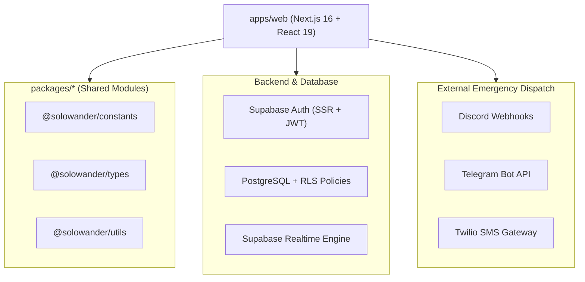

# SoloWander

<div align="center">

[](https://github.com/akshat-shaw-509/SoloWander/actions/workflows/ci.yml)
[](https://github.com/akshat-shaw-509/SoloWander/actions/workflows/codeql.yml)
[](https://nextjs.org/)
[](https://react.dev/)
[](https://www.typescriptlang.org/)
[](https://tailwindcss.com/)
[](https://turbo.build/repo)
[](https://supabase.com/)
[](LICENSE)

**The intelligent travel companion built specifically for solo adventurers.**  
Empowering solo travelers with real-time safety monitoring, offline-first emergency dispatch, budget tracking, hostel recommendations, and community support.

[Live Demo](#deployment) • [Key Features](#features) • [Architecture](#architecture) • [Getting Started](#quick-start) • [Deployment](#deployment)

</div>

---

## 🌟 Key Features

### 🛡️ Mission-Critical Safety System
- **Real-Time Location Tracking**: Continuous GPS coordinates sync with configurable intervals and battery awareness.
- **Offline-First SOS Dispatch**: Queue emergency signals locally when connection drops; syncs automatically once reconnected.
- **Multi-Channel Emergency Broadcast**: Multi-target alerts dispatched automatically via:
  - 💬 **Discord Webhooks** (Free instant channel broadcast)
  - 🤖 **Telegram Bot API**
  - 📱 **Twilio SMS**
- **Authority Command Center**: Dedicated dashboard for emergency responders and trip coordinators to monitor live status, view geofence breaches, and resolve active incidents.

### 🗺️ Smart Trip & Route Planning
- Dynamic itinerary builder with day-by-day activity planning.
- Intelligent transit suggestions customized for solo travelers.

### 💰 Affordability & Budget Engine
- Live expense tracking with category breakdowns (Accommodation, Food, Transit, Activities).
- Local cost benchmarks and smart budget recommendations.

### 🛏️ Solo Community & Hostels
- Curated hostel recommendations scored for solo-traveler friendliness, social atmosphere, and security.
- Verified reviews and solo traveler tips.

---

## 🏗️ Architecture

SoloWander is architected as an enterprise-grade Turborepo monorepo:



### Directory Structure

```
SoloWander/
├── .github/
│   ├── workflows/             # CI/CD, CodeQL, and Docker GitHub Actions
│   ├── ISSUE_TEMPLATE/        # Structured bug & feature request templates
│   └── dependabot.yml         # Automated dependency security scanners
├── apps/
│   └── web/                   # Next.js 16 App Router application
│       ├── src/app/           # Routes (Dashboard, Safety, Trips, Auth)
│       ├── src/components/    # Reusable UI & Safety Controls
│       └── src/lib/           # Supabase client, safety sync, dispatch
├── packages/
│   ├── constants/             # Shared constants and configurations
│   ├── types/                 # Shared TypeScript models and interfaces
│   └── utils/                 # Formatting and calculation utilities
├── supabase/
│   └── migrations/            # SQL migrations, RLS policies, seeds
├── Dockerfile                 # Multi-stage production container build
├── docker-compose.yml         # Container orchestration configuration
├── vercel.json                # Vercel deployment configuration
└── turbo.json                 # Turborepo task pipeline
```

---

## 🚀 Quick Start

### Prerequisites

- **Node.js**: `>= 20.9.0`
- **npm**: `>= 10.0.0`
- A [Supabase](https://supabase.com) project

### Installation

1. **Clone the repository:**
   ```bash
   git clone https://github.com/akshat-shaw-509/SoloWander.git
   cd SoloWander
   ```

2. **Install all dependencies:**
   ```bash
   npm install
   ```

3. **Configure Environment Variables:**
   ```bash
   cp .env.example apps/web/.env.local
   ```
   *(On Windows PowerShell, run: `Copy-Item .env.example apps/web/.env.local`)*

   Fill in your Supabase credentials:
   ```env
   NEXT_PUBLIC_SUPABASE_URL=https://your-project.supabase.co
   NEXT_PUBLIC_SUPABASE_ANON_KEY=your-supabase-anon-key
   ```

4. **Initialize Database Schema:**
   Apply migrations from `supabase/migrations/` in your Supabase SQL Editor:
   - `001_init.sql` (Tables and relationships)
   - `002_rls.sql` (Row-Level Security policies)
   - `004_tourist_safety_system.sql` (SOS and incident logs)
   - `005_authority_command_center.sql` (Authority views)
   - `006_offline_first_sos.sql` (Offline sync idempotency)

5. **Start Development:**
   ```bash
   npm run dev --workspace=web
   ```
   Open [http://localhost:3000](http://localhost:3000).

---

## 🧪 Quality Gates & Testing

SoloWander enforces strict automated quality gates:

```bash
# Lint all workspaces with zero tolerance
npm run lint

# TypeScript static type check
npm run typecheck

# Full production build verification
npm run build
```

---

## 🚢 Deployment

### Option 1: Vercel (Recommended for Web)

1. Import your GitHub repository into [Vercel](https://vercel.com/new).
2. Set **Root Directory** to `apps/web`.
3. Select **Next.js** framework.
4. Set Environment Variables:
   - `NEXT_PUBLIC_SUPABASE_URL`
   - `NEXT_PUBLIC_SUPABASE_ANON_KEY`
   - *(Optional)* `DISCORD_SOS_WEBHOOK_URL`
5. Click **Deploy**. Vercel will build using the monorepo cache.

### Option 2: Docker Container (Production / Cloud / VPS)

SoloWander includes a lightweight, secure multi-stage Docker build utilizing Next.js `standalone` output:

```bash
# Build and run with Docker Compose
docker compose up --build -d
```

Test the container health check:
```bash
curl http://localhost:3000/api/health
```

### Option 3: Railway / Render / Fly.io

Use the included [Dockerfile](Dockerfile) which exposes port `3000` and configures non-root system permissions with integrated health checks.

---

## 🔐 Environment Variables

| Variable | Description | Required | Scope |
| :--- | :--- | :---: | :--- |
| `NEXT_PUBLIC_SUPABASE_URL` | Your Supabase project URL | Yes | Client & Server |
| `NEXT_PUBLIC_SUPABASE_ANON_KEY` | Supabase publishable anon key | Yes | Client & Server |
| `DISCORD_SOS_WEBHOOK_URL` | Discord webhook for emergency alerts | Optional | Server-side |
| `TELEGRAM_BOT_TOKEN` | Telegram bot token for SOS alerts | Optional | Server-side |
| `TELEGRAM_CHAT_ID` | Telegram chat ID for emergency alerts | Optional | Server-side |
| `TWILIO_ACCOUNT_SID` | Twilio Account SID for SMS dispatch | Optional | Server-side |
| `TWILIO_AUTH_TOKEN` | Twilio Auth Token for SMS dispatch | Optional | Server-side |
| `TWILIO_FROM_PHONE_NUMBER` | Twilio phone number for SMS dispatch | Optional | Server-side |
| `TWILIO_TO_PHONE_NUMBER` | Emergency recipient phone number | Optional | Server-side |

---

## 🤝 Contributing

Contributions make the open-source community thrive! Please see [CONTRIBUTING.md](CONTRIBUTING.md) for full contribution guidelines, coding standards, and branch policies.

---

## 📄 License

This project is licensed under the MIT License - see the [LICENSE](LICENSE) file for details.